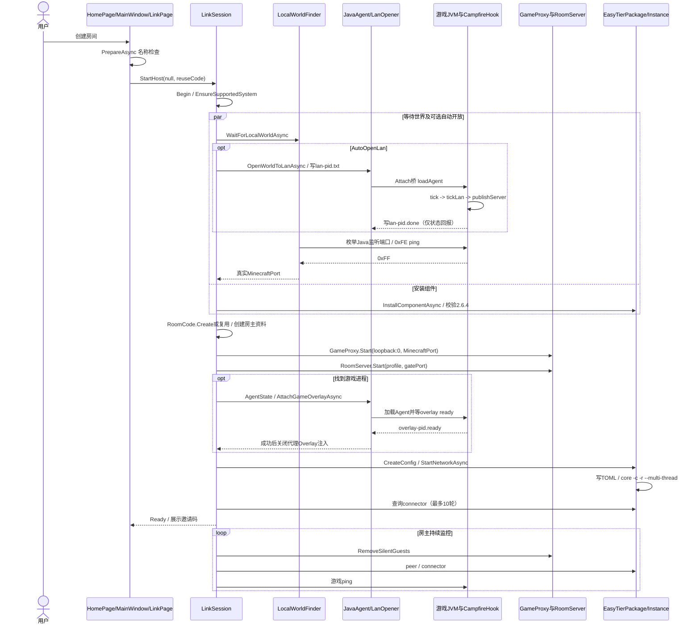
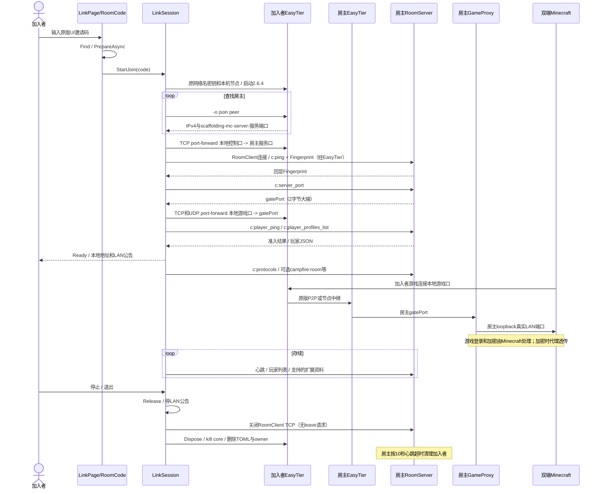

# Campfire Linux CLI 移植前源码审计

> 此文件是移植前审计的归档副本，代码链接固定到原版提交。当前Linux实现与测试状态见 [LINUX_PORT_IMPLEMENTATION.md](LINUX_PORT_IMPLEMENTATION.md)。下文的“本次”指审计任务，非当前移植实施。

## 1. 审计边界与结论

审计基线：本地仓库提交 `20bd056f648c858161cbe7b4d881f402fb4544b0`。原工程版本为 `1.1.31`，目标是 `net48`、`WinExe`、`UseWPF=true`，见 [src/Campfire/Campfire.csproj:3–26](https://github.com/Xocio/Campfire/blob/20bd056f648c858161cbe7b4d881f402fb4544b0/src/Campfire/Campfire.csproj#L3)。本次只新增本文件；没有修改业务文件、工程配置、JAR 或节点列表，没有构建或开始移植。

本报告以本地源码为事实依据。文中“可复用”表示静态审计未发现必须改写的协议或平台调用，不表示已经在 Ubuntu 验证通过。所有 Linux 运行结果、外部服务状态和未随仓库提供的 EasyTier 内部行为均标为“待确认”。未访问公共节点、下载运行 EasyTier、附加真实游戏进程或进行 Windows/Linux 联机实验。

主要结论及其证据：

| 结论 | 源码证据 |
| --- | --- |
| 应保留原版邀请码、房间二进制帧、成员资料和握手，复用现有实现 | `RoomCode`，`src/Campfire/Link/RoomCode.cs:14–125`；`RoomProtocol`、`RoomFraming`，`src/Campfire/Link/Room/RoomProtocol.cs:6–47`、`RoomFraming.cs:16–101` |
| 联机是 EasyTier 无 TUN 网络加动态端口转发；房主另有 C# 游戏网关 | `EasyTierConfig.ToToml()`，`src/Campfire/Link/Runtime/EasyTierConfig.cs:41–95`；`LinkSession.StartHost()/StartJoin()`，`src/Campfire/Link/LinkSession.cs:289–311, 470–501` |
| 原版固定 EasyTier **2.6.4**，当前安装器只实现 Windows 二进制下载和校验 | `EasyTierPackage.Version/Files/GetSourceUrls()`，`src/Campfire/Link/Runtime/EasyTierPackage.cs:24–54, 167–175` |
| 邀请码不携带节点、IP、端口或中继策略；两端各读本机设置，配置未必相同 | `RoomCode` 构造器，`src/Campfire/Link/RoomCode.cs:26–46`；`LinkSession.CreateConfig()`，`LinkSession.cs:1504–1516`；`LinkSettings.GetNodes()`，`src/Campfire/Link/LinkSettings.cs:267–279` |
| 房间握手为固定字节回显；未发现独立的账号口令、签名或挑战应答认证 | `RoomClient.TryConnectAsync()`，`src/Campfire/Link/Room/RoomClient.cs:33–65`；`RoomServer.Handle()/HandlePlayerPing()`，`RoomServer.cs:220–303`。网络密钥交给 EasyTier；Minecraft 登录交给游戏 |
| Java Agent 的 Java 部分值得直接复用，Linux JVM Attach 成功率尚不能确认 | `CampfireAttach.main()` 使用 `VirtualMachine.attach/loadAgent/detach`，`src/java-agent/src/CampfireAttach.java:15–34`；C# 查找器硬编码 `java.exe`，`src/Campfire/Link/Minecraft/JavaAgent.cs:184–301` |
| 最大平台障碍在进程发现、端口归属、二进制安装和进程生命周期；不应重写房间协议 | `GameAccount.ReadCommandLine()`，`src/Campfire/Link/Minecraft/GameAccount.cs:128–212`；`LocalWorldFinder.ReadListeners()/ReadUdpSockets()`，`LocalWorldFinder.cs:99–184`；`ChildProcessJob`，`src/Campfire/Link/Runtime/ChildProcessJob.cs:10–110` |

后续方案严格限于 Ubuntu 22.04 x86_64 CLI，与未修改的 Windows 原版双向联机。不得新增节点、中继、服务器或协议功能；不得用更新版 EasyTier、其他网络名/密钥算法或自定义隧道代替原版实现。原版支持自定义节点的事实应保留在审计中，但**不构成本项目添加自定义节点的授权**。

## 2. 原版创建房间完整调用链

### 2.1 从用户操作到会话入口

| 顺序 | 实际类/方法 | 行为及源码位置 |
| --- | --- | --- |
| 1 | `HomePage.TileCreate_Click()` | 首页按钮 `TileCreate` 在 `src/Campfire/Pages/HomePage.xaml:87` 绑定；方法在 `HomePage.xaml.cs:133–136` 触发 `CreateRequested` |
| 2 | `MainWindow.PageHome_CreateRequested()` | `src/Campfire/MainWindow.xaml:158–159` 绑定事件；`MainWindow.xaml.cs:274–278` 调用 `PageLink.CreateAsync()`，再显示页面 |
| 3 | `LinkPage.CreateAsync(RoomCode code = null)` | `src/Campfire/Pages/LinkPage.xaml.cs:231–244`；已有活动房间直接返回；否则 `PrepareAsync()`，保存重试状态，调用 `_session.StartHost(null, code)` |
| 4 | `LinkPage.PrepareAsync()` | `LinkPage.xaml.cs:292–303`；依次调用 `RequirePlayerNameAsync()` 和 `CheckGameNameAsync()`。前者要求显示名并可调用原服务名称过滤，后者刷新游戏账号并对不合法游戏名弹窗，见同文件 `936–994` |
| 5 | `LinkSession.StartHost(int? manualPort, RoomCode reuseCode = null)` | `src/Campfire/Link/LinkSession.cs:255–337`；`Begin(Host)` 释放旧资源、重置状态；`EnsureSupportedSystem()` 检查原版 Windows 条件 |

其他入口最终汇入同一链路：最近房间通过 `MainWindow` 构造器订阅 `PageRecent.HostRequested`，调用 `CreateAsync(code)`（`MainWindow.xaml.cs:64–68`）；大厅创建事件也订阅 `PageHome_CreateRequested`（`:70`）；世界页面 `PageWorld_CreateRoomRequested()` 转到该方法（`:364–366`）；托盘也转到该方法（`:544–548`）。手动指定端口入口为 `LinkPage.BtnUsePort_Click()`，校验 `1..65535` 后调用 `StartHost(port, _lastHostCode)`（`LinkPage.xaml.cs:1082–1096`）。

### 2.2 `StartHost()` 内部实际执行顺序

下列顺序来自 [src/Campfire/Link/LinkSession.cs:255–337](https://github.com/Xocio/Campfire/blob/20bd056f648c858161cbe7b4d881f402fb4544b0/src/Campfire/Link/LinkSession.cs#L255)，不是按网络库通用用法推定：

1. `Begin(Host)` → `EnsureSupportedSystem()`。`Begin()` 先 `Release()`，创建新的 `CancellationTokenSource`，设置 `Working`（同文件 `1256–1301`）。
2. 启动世界等待任务：手动端口用 `Task.FromResult(manualPort.Value)`；否则 `LocalWorldFinder.WaitForLocalWorldAsync(token)`。自动模式且 `LinkSettings.AutoOpenLan=true` 时并发启动 `OpenWorldToLanAsync(run, world)`（`265–269`）。
3. `InstallComponentAsync(token)` → `EasyTierPackage.InstallAsync()`，与世界发现并行推进；安装完成后 `await world`。手动端口还必须通过 `MinecraftProbe.IsServerAsync(port, 3s)`（`270–278`；安装方法 `1471–1491`）。
4. 记录真实 `MinecraftPort`；`Code = reuseCode ?? RoomCode.Create()`。所以邀请码在 EasyTier 启动**之前**生成，界面进入 `Ready` 后才正常展示、自动复制。后台启动 `BackupWorldAsync()`（`278–284`；自动复制见 `LinkPage.Render()`，`LinkPage.xaml.cs:343–353`）。
5. `GameAccount.RefreshAsync()` → `PlayerProfile.CreateLocal(Host)`（`285–286`）。显示名、随机机器标识和可选游戏账号资料成为房主资料，详见第 4 节。
6. `GameProxy.Start(new IPEndPoint(Loopback, 0), port, BuildGameOverlay)`，得到系统分配的本地网关端口；设置 `Refuse = RefuseGamePlayer`（`289–290`）。
7. `RoomServer.Start(_self, _gate.Port)`，再赋值 `Room = CurrentRoomInfo()`，订阅 `PlayersChanged`，后台 `PrepareModsAsync()`（`291–294`）。注意传入的是 `_gate.Port`，并非真实 Minecraft LAN 端口。
8. `WorldGameProcess(port)` 尝试找到 LAN 监听进程，且要求 `RunningGame.FromProcess(owner)` 能识别；找不到时回退 `GameAccount.Current?.ProcessId`。找到后创建 `AgentState` 并后台 `AttachGameOverlayAsync()`（`296–305, 446–452`）。
9. `CreateConfig(Code, "scaffolding-mc-server-" + _server.Port, "10.144.144.1")`，TCP 白名单加入房间服务端口和网关端口，UDP 白名单加入网关端口（`307–310`）。
10. `StartNetworkAsync(config, run)` → `EasyTierInstance.Start()`；最多进行 10 次公共节点连接数查询，未连接时每次等待 1 秒。没有节点也没有在这里直接抛出失败，随后设置 `Ready`（`311–324`）。
11. `RoomHistory.Record()`、同意统计时 `Telemetry.Count("link.host")`；语音设置开启才后台 `PrepareVoiceAsync()`；持续 `MonitorHostAsync()`（`325–331`）。

关键调用原文（`LinkSession.StartHost()`，`289–311`，节选）：

```csharp
_gate = GameProxy.Start(new IPEndPoint(IPAddress.Loopback, 0), port, BuildGameOverlay);
_gate.Refuse = RefuseGamePlayer;
_server = RoomServer.Start(_self, _gate.Port);
// ...
var config = CreateConfig(Code, RoomProtocol.HostNamePrefix + _server.Port, RoomProtocol.HostAddress);
config.TcpWhitelist.Add(_server.Port.ToString());
config.TcpWhitelist.Add(_gate.Port.ToString());
config.UdpWhitelist.Add(_gate.Port.ToString());
await StartNetworkAsync(config, run);
```

### 2.3 RoomServer 创建、启动和存续

`RoomServer.Start()`（[src/Campfire/Link/Room/RoomServer.cs:120–138](https://github.com/Xocio/Campfire/blob/20bd056f648c858161cbe7b4d881f402fb4544b0/src/Campfire/Link/Room/RoomServer.cs#L120)）先尝试 `127.0.0.1:13448`；捕获 `SocketException` 后改为 `127.0.0.1:0`。构造实例后后台运行 `AcceptLoopAsync()`（`:174–189`），每个 TCP 连接启动 `ServeAsync()`（`:191–218`）。`ServeAsync()` 用 64 秒空闲超时、与 `_stop` 关联的取消令牌和关闭套接字回调，循环读取请求、调用 `Handle()`、写响应。

`RoomServer.Handle()`（`:220–263`）按协议名分发，`c:server_port` 返回构造时保存的 `_minecraftPort` 的两字节大端表示；在当前房主链路中，该字段实际是 **GameProxy 网关端口**。房间名、公告、人数上限来自 `LinkSession.CurrentRoomInfo()`（`LinkSession.cs:1128–1131`），转为 `RoomInfo` 的 `name/notice/max` JSON（`RoomInfo.cs:11–44`）。

`LinkSession.MonitorHostAsync()`（`LinkSession.cs:339–379`）每轮等待 2 秒，清理 10 秒无心跳的成员、读取 EasyTier peers；每三轮查询节点连接数并探测真实 `MinecraftPort`。连续 3 次游戏探测失败关闭房间；若因语音准备需重启游戏，则 `ReturnToWorldAsync()` 最多等待 10 分钟、保留邀请码并更新 `_gate.TargetPort`（`:385–440`）。这不是每次世界变化都重新生成房间。

## 3. Java Agent 和 Minecraft LAN 流程

### 3.1 自动开放 LAN 的请求、执行和端口确认

`LinkSession.OpenWorldToLanAsync()`（[src/Campfire/Link/LinkSession.cs:1374–1449](https://github.com/Xocio/Campfire/blob/20bd056f648c858161cbe7b4d881f402fb4544b0/src/Campfire/Link/LinkSession.cs#L1374)）在世界等待任务完成前，每 2 秒调用 `Worlds.RunningGame.Find()`，对新发现的每个游戏 PID：

1. 创建 `LanOpener(pid, null)`，`world=null` 对应 `*`；**先写 LAN 请求文件，再加载 Agent**。
2. `JavaAgent.LoadAsync(pid, token)` 加载失败则移除并 `Dispose()` 该 opener；已经关闭的游戏也清理。
3. 周期调用 `LanOpener.ReadResult()`，结果仅用于记录日志和显示自动开放状态。**返回的 port 没有直接成为 `StartHost()` 的 MinecraftPort**；真正完成世界等待的仍是端口发现加游戏 ping。

`LanOpener` 的实现见 [src/Campfire/Link/Minecraft/LanOpener.cs:33–108](https://github.com/Xocio/Campfire/blob/20bd056f648c858161cbe7b4d881f402fb4544b0/src/Campfire/Link/Minecraft/LanOpener.cs#L33)：

| 文件/字段 | 写入/读取者与含义 |
| --- | --- |
| `<LinkSettings.DataDirectory>/lan-<pid>.txt` | C# `LanOpener.Write()` 每 3 秒写 `time=<Unix毫秒>`、`world=*或世界目录名`、`id=<随机请求ID>`、`opened=<本地化消息>`，UTF-8 无 BOM，临时文件后 `File.Replace/Move` |
| `lan-<pid>.done` | Java `CampfireHook.writeLanResult()` 写 `port=<正数>`、`port=already` 或 `port=0`（`src/java-agent/src/CampfireHook.java:374–388, 515–521`） |
| `ReadResult()` | 不存在返回 `null`；`already` 返回 0；正数返回端口；非法内容或失败返回 -1（`LanOpener.cs:51–68`）。`Dispose()` 删除请求和结果文件（`:71–82`） |

游戏内调用链是 `CampfireTransformer.transform()` → 在 `MinecraftServer` tick 方法头部插入 `CampfireHook.tick(this)` → `initialize()` → `tickLan()` → `publish()`。证据：`src/java-agent/src/CampfireTransformer.java:16–75`；`CampfireHook.java:130–167, 171–231, 340–401, 418–457`。

`tickLan()` 每 2 秒检查请求文件，超过 15 秒的 `time` 被视为失效；要求游戏中已有玩家至少 3 秒，每个 server 实例/请求 ID 只执行一次。已开放则写 `already`。`publish()` 按实际可反射到的方法分支：

| 分支 | 实际方法与证据 |
| --- | --- |
| 源码注释标注 26.2+ | `publishServer(MultiplayerScope.LAN, port)`，`CampfireHook.java:422–430` |
| 源码注释标注 1.14–26.1 | `publishServer(GameType, boolean cheats, int port)`，保留游戏当前模式，`allowCommands()` 读取当前作弊设置，`:433–440, 459–492` |
| 旧版分支，源码以 1.8.9 作示例 | `publishServer(GameType, boolean cheats)`，解析返回的端口字符串，`:443–450` |
| 需要自行选端口时 | `HttpUtil.getAvailablePort()`，`:453–457` |

这些版本标签是仓库内注释和分支设计，不等于所有相应发行版和模组组合均通过验证；具体支持矩阵为**待确认**。不能只根据 `CampfireTransformer` 注释声称 Agent 从不改变世界状态：Hook 中确实有上述开放 LAN 调用。

### 3.2 真实游戏端口获取

`LocalWorldFinder.WaitForLocalWorldAsync()`（[src/Campfire/Link/Minecraft/LocalWorldFinder.cs:28–93](https://github.com/Xocio/Campfire/blob/20bd056f648c858161cbe7b4d881f402fb4544b0/src/Campfire/Link/Minecraft/LocalWorldFinder.cs#L28)）每 1500 毫秒读取 Java 进程监听端口，按端口排序，逐个调用 `MinecraftProbe.IsServerAsync(port, 2s)`；不响应的端口跳过 20 秒。监听表来自 Windows `GetExtendedTcpTable`，同时处理 IPv4/IPv6（`:99–184`）。它不是监听 Minecraft 的 LAN 组播来获取房主端口。

`MinecraftProbe.ExchangeAsync()`（`src/Campfire/Link/Minecraft/MinecraftProbe.cs:17–42`）连接 `127.0.0.1:port`，发送旧版服务器列表 ping `0xFE`，首字节响应 `0xFF` 即判定为游戏。手动端口也用此机制。IPv6 监听虽会被列举，但探测目标固定 IPv4 loopback；仅 IPv6 的游戏是否可发现为**待确认**。多个世界并行时默认取第一个满足条件的端口，不能保证与最后一个收到 Agent 请求的游戏相同。

### 3.3 Agent 提取、Attach 和 tick 注入

| 层次 | 实际实现及源码证据 |
| --- | --- |
| 打包 | `Campfire.csproj:76–80` 嵌入 `CampfireAgent.jar`、`CampfireHook.jar`、`CampfireAttach.jar` 和旧版 mappings |
| 映射准备 | `JavaAgent.LoadAsync()` 先调用 `GameMappings.PrepareAsync(pid)`；从游戏命令行定位版本 JSON，按 `inheritsFrom` 找 `downloads.client_mappings.url/sha1`，或按 client JAR SHA-1 选内置表。`src/Campfire/Link/Minecraft/JavaAgent.cs:74–92`；`GameMappings.cs:43–121, 128–153` |
| 映射下载 | 优先版本 JSON 给出的 URL；若是 `https://piston-data.mojang.com/`，追加原版 `https://bmclapi2.bangbang93.com/` 镜像，下载内容校验 SHA-1；已存在的缓存路径直接返回，未在该分支重验内容。`GameMappings.PrepareAsync()/Urls()`，`GameMappings.cs:81–107, 216–229` |
| Attach JVM 选择 | `FindAttachJava()` → `AttachCandidates(FindJava(pid))` → `CanAttach()`；优先游戏本身，再扫描 Windows runtime、`JAVA_HOME/bin/java.exe` 和 Program Files 厂商目录。运行 `java --list-modules` 查 `jdk.attach@`。`JavaAgent.cs:184–301` |
| 提取资源 | `LoadAsync()` 用全局 `SemaphoreSlim` 串行化；按三个嵌入资源各自 SHA-256 前 16 个十六进制字符组合缓存目录 `Link/agent/v...`，提取三个 JAR 到同一目录。`JavaAgent.cs:94–110, 304–335` |
| 启动桥接进程 | `java --add-modules jdk.attach -cp "<CampfireAttach.jar>" campfire.CampfireAttach <pid> "<CampfireAgent.jar>" "state=<Link目录>[\|mappings=<映射文件>]"`；重定向输出；最多等 20 秒，超时 kill。`JavaAgent.LoadAsync()`，`JavaAgent.cs:112–155` |
| 标准 Attach | `CampfireAttach.main()` 调用 `VirtualMachine.attach(pid)` → `loadAgent(agentJar, options)` → `finally detach()`；对 Java 8 成功加载却报告 `0` 的 `AgentLoadException` 特判。`src/java-agent/src/CampfireAttach.java:15–34` |
| Agent 入口 | `CampfireAgent.agentmain()` 解析 `state/mappings`、设置 `campfire.state`、同 JVM 只安装一次；相邻的 Hook JAR 加入 bootstrap search；`CampfireNames.load()` 载入名称表，添加可重转换的 transformer，对已加载的 `MinecraftServer` 调用 `retransformClasses()`。`CampfireAgent.java:26–88` |
| ASM 注入 | `CampfireTransformer.transform()` 仅匹配 `net/minecraft/server/MinecraftServer`，选择官方或映射后的 tick 方法；BooleanSupplier 描述符或旧版 `()V`，方法头插入 `CampfireHook.tick(Object)`。`CampfireAgent.java:64–71`；`CampfireTransformer.java:19–71` |

### 3.4 房间 Overlay 与退出后的 Agent

`AgentState`（`src/Campfire/Link/Minecraft/JavaAgent.cs:348–442`）每 3 秒写 `overlay-<pid>.txt`，包括时间、本地化文字和房间公告。`JavaAgent.AttachAsync()` 先 `LoadAsync()`，再最多等待 6 秒看 `overlay-<pid>.ready`（同文件 `42–68`）。Hook 每 2 秒读状态，首次激活时 `markReady()`；状态失效时 `clear()` 清除 Tab 头尾（`CampfireHook.java:525–539, 638–689`）。`LinkSession.AttachGameOverlayAsync()` 只有得到此确认才关闭代理注入的 Overlay（`LinkSession.cs:1347–1367`）。

状态目录优先读取 `campfire.state`，然后才回退 `LOCALAPPDATA` 或 `user.home`；PID 来自 `RuntimeMXBean`（`CampfireHook.stateDirectory()/pid()`，`:614–631`）。日志也有 Linux 可用的 `user.home/.campfire-agent.log` 回退（`CampfireHook.log()`，`:859–871`）。

`AgentState.Dispose()` 删除状态和 ready 文件；`LanOpener.Dispose()` 删除 LAN 请求和结果。**没有卸载 transformer、卸载 Agent 或关闭 Minecraft LAN 的实现**。`CampfireAttach.detach()` 只是断开 Attach 会话；Agent 和 Hook 留在游戏 JVM，靠文件失效停止工作。证据：`JavaAgent.cs:381–392`、`LanOpener.cs:71–82`、`CampfireAgent.java:42–46, 71–79`、`CampfireHook.java:340–348, 525–542`。CLI 退出应维持这种原版语义，不能擅自杀游戏或关闭世界。

### 3.5 Linux JVM 可行性判断

静态结论：Java 源码使用标准 Java Attach/Instrumentation、ASM、反射和 NIO 文件接口，未发现 JNI、JNA、自带 Windows DLL、命名管道 Attach 或 Win32 注入代码。原版没有需要“重写成 Linux”的专有 Java Attach 算法；需要适配的是找到 JVM、构造启动参数、定位 mappings 和状态目录等宿主侧能力。依据为 `CampfireAttach.java:3–34`、`CampfireAgent.java:3–88`、`CampfireTransformer.java:3–75`、`CampfireHook.java:3–23, 614–668`。

`src/java-agent/build.ps1:30–42` 将 Agent/Hook 编译为 `--release 8`、Attach 桥编译为 `--release 9 --add-modules jdk.attach`，构建脚本要求 JDK 21+（`:5`）。脚本本身使用 PowerShell、反斜杠和 `;` classpath（`:8, 37`），构建环境若改到 Linux 需要适配脚本；**优先原样使用仓库已提供的 JAR，不必为了 CLI 重写 Agent**。

只读检查了仓库 JAR 的 manifest 和 class header：Agent/Hook 的 Campfire 类 major 为 52，Attach 为 53；manifest 与 `build.ps1:54–69` 的 `Agent-Class/Main-Class/Can-Retransform-Classes` 一致。这只证明制品结构，不证明 Java 源码与 JAR 全量逐字节一致，也不证明运行成功。

| 仓库制品 | 本次读取到的 SHA-256 |
| --- | --- |
| `src/java-agent/dist/CampfireAgent.jar` | `aa3e777228b74a5675e9dea300fd01aaae384d2bd15d7472563c4514aad467fe` |
| `src/java-agent/dist/CampfireHook.jar` | `c42b92f861580261830ba88638d8582b846300cdc4cca203c9e9aea3ea19416e` |
| `src/java-agent/dist/CampfireAttach.jar` | `b6919b696c45681a5adbf590407c396d5975f94a7f74192a6687d8bbb061be0a` |

Linux 必须实测且目前均为**待确认**：相同用户下 Attach 权限、目标 JVM 是否禁用动态附加、`jdk.attach` 可用性、Java 9+ 桥向 Java 8 游戏附加、不同 JVM 厂商/架构、容器或沙箱中的 PID/路径可见性、反射与 retransformation 在各 Minecraft/加载器组合下的行为。仓库没有 Linux Attach 测试或发行兼容矩阵，不能宣称已经支持。

## 4. 原版加入房间完整调用链

### 4.1 用户入口与邀请码解析

首页 `HomePage.TileJoin_Click()`（`src/Campfire/Pages/HomePage.xaml.cs:138–141`）→ `MainWindow.PageHome_JoinRequested()`（`src/Campfire/MainWindow.xaml.cs:280–284`）→ `LinkPage.ShowJoin()`（`src/Campfire/Pages/LinkPage.xaml.cs:247–267`）。用户确认按钮在 `LinkPage.xaml:199–201` 绑定 `BtnJoinConfirm_Click()`；它调用 `RoomCode.Find(TxtCode.Text)`、`PrepareAsync()`，再 `StartJoin(code)` → `_session.StartJoin(code)`（`LinkPage.xaml.cs:1024–1045`）。

快捷邀请、最近房间、大厅得到邀请码后走 `LinkPage.JoinAsync()` → `StartJoin()`（`LinkPage.xaml.cs:271–280`；`MainWindow.xaml.cs:59–63, 286–290, 334–338`）。`ShowJoin()` 和粘贴按钮也复用 `RoomCode.Find()`，未另造解析器。

`RoomCode.Find()/TryDecode()/DigitOf()`（[src/Campfire/Link/RoomCode.cs:76–119](https://github.com/Xocio/Campfire/blob/20bd056f648c858161cbe7b4d881f402fb4544b0/src/Campfire/Link/RoomCode.cs#L76)）扫描整段文字中首个合法 `U/XXXX-XXXX-XXXX-XXXX`，忽略大小写，将 `I/O` 归一为 `1/0`，严格检查分组连字符和数值能否被 7 整除。没有节点参数、服务地址或 JSON 解码步骤。生成算法详见第 5.3 节。

### 4.2 `StartJoin()` 的网络、发现和转发

按 [src/Campfire/Link/LinkSession.cs:457–539](https://github.com/Xocio/Campfire/blob/20bd056f648c858161cbe7b4d881f402fb4544b0/src/Campfire/Link/LinkSession.cs#L457) 的真实顺序：

1. `Begin(Guest)`、保存 `Code`、`EnsureSupportedSystem()`、`InstallComponentAsync()`。
2. 刷新游戏账号、`PlayerProfile.CreateLocal(Local)`；`CreateConfig(code, "campfire-" + Hex.Random(4), null)`。`IPv4=null` 生成 `dhcp=true`；两类入站白名单均只有 `"0"`，随后启动 EasyTier。
3. `FindHostAsync(config.DirectOnly, config.HideAddress, token)` → `_network.GetPeersAsync()`，经 `IsRoomHost()` 找 **非本地、IPv4 非空、Hostname 以 `scaffolding-mc-server-` 开头、尾部是有效端口** 的成员（`LinkSession.cs:541–586`）。从该 peer 的 `IPv4` 取得房主地址，从 Hostname 尾部取得房间服务端口。
4. 本地选空闲 `_serviceLocalPort`；`AddPortForwardAsync("tcp", 127.0.0.1:<serviceLocalPort>, <hostIPv4>:<servicePort>)` 建立控制通道。
5. `ConnectRoomAsync()` → `RoomClient.TryConnectAsync()`，成功后 `GetServerPortAsync()` 获取远端游戏**网关**端口（`489–490, 588–599`）。
6. 依据 `LinkSettings.ShareWithLan` 选 `IPAddress.Any` 或 `Loopback`；`ChooseLocalPort()` 优先用户指定端口，否则房主网关端口，再选空闲端口（`1532–1551`）。建立 `tcp` **和** `udp` 的本地端口转发到房主 `<IPv4>:<gatePort>`；共享 LAN 时另尝试 IPv6Any TCP 转发，返回值没有参与失败判定（`491–501`）。
7. 最多 6 次 `MinecraftProbe.IsServerAsync(localPort, 4s)`，失败只记录 warning，仍继续；上报带延迟的首个心跳、拉玩家列表（`505–517`）。
8. 创建 `LanWorldAnnouncer(LanEntryWithStatus, localPort, !IsSharedWithLan)`，设置 `Ready`、记录历史、统计计数；后台读取 mods、语音、房间信息，进入 `MonitorGuestAsync()`（`518–533`）。

`EasyTierPeer.FromJson()` 的字段约定必须保留：`hostname`、`ipv4`、`cost`、`lat_ms`、`tunnel_proto`、`nat_type`；`cost == "Local"` 判定本地，`cost == "p2p"` 判定直连，`IPv4` 非空判定成员（`src/Campfire/Link/Runtime/EasyTierPeer.cs:30–46`）。这里的发现不是请求独立房间目录服务器。

### 4.3 身份、握手、认证的实际边界

| 层次 | 原版行为 | 证据 |
| --- | --- | --- |
| EasyTier 网络身份 | 从邀请码导出 `network_name/network_secret` 写入 TOML；由 EasyTier 执行网络层身份校验。具体密码学握手和默认加密算法在本仓库无实现，**待确认** | `RoomCode.cs:43–45`；`EasyTierConfig.ToToml()`，`EasyTierConfig.cs:56–58` |
| 房间服务确认 | TCP 连接后发送 `c:ping` 和固定 16 字节 Fingerprint；服务端原样回显；客户端检查状态 0 和内容相等。不是随机挑战，也不是用户证书 | `RoomClient.TryConnectAsync()`，`RoomClient.cs:33–65`；`RoomProtocol.cs:44–47`；`RoomServer.Handle()`，`RoomServer.cs:226–227` |
| 房间成员身份 | `machine_id` 是持久化随机 16 字节的 32 字符 hex 文本，不是硬件指纹；心跳 JSON 自报 `name/machine_id/vendor`，可选 `uuid/game_name/latency_ms` | `LinkSettings.LoadOrCreateMachineId()`，`LinkSettings.cs:342–368`；`PlayerProfile.CreateLocal()/ToJson()`，`src/Campfire/Link/Room/PlayerProfile.cs:64–105` |
| 心跳准入 | 校验资料、拒绝与房主相同 machine ID、检查黑名单、1 分钟移除期及人数上限；没有在该处理函数中验证账号 token 或资料签名 | `RoomServer.HandlePlayerPing()`，`RoomServer.cs:265–303`；`Blocklist.Contains()`，`src/Campfire/Link/Blocklist.cs:91–105` |
| 本机游戏账号读取 | 只从 Java 命令行选取 `--username/--uuid/--userType`，判断 `msa/mojang` 和 UUID 长度；不是重新向微软登录 | `GameAccount.Detect()`，`src/Campfire/Link/Minecraft/GameAccount.cs:50–83`；`PlayerProfile.CreateLocal()` 受 ShowSkins 开关控制 UUID 共享 |
| Minecraft 登录 | `GameProxy.Connection.RunAsync()` 透传游戏握手和登录请求；读取玩家名做原版拒绝判断；遇加密请求切到原始流透传，不执行 token 替换、离线认证伪造或加密终止 | `GameProxy.cs:229–298, 343–378`；`LinkSession.RefuseGamePlayer()`，`LinkSession.cs:709–719` |

固定 Fingerprint 原文（`RoomProtocol.cs:44–47`）：

```csharp
0x41, 0x57, 0x48, 0x44, 0x86, 0x37, 0x40, 0x59,
0x57, 0x44, 0x92, 0x43, 0x96, 0x99, 0x85, 0x01
```

`RoomServer.Handle()` 没有“已通过 Ping/心跳”状态检查，`c:server_port` 可以在首个心跳之前读取；`StartJoin()` 也确实先建游戏转发再发首个心跳。审计不能将该顺序描述为强认证会话，也不能在移植时自行增加认证层（`RoomServer.cs:220–255`；`LinkSession.cs:489–516`）。

### 4.4 房间帧、资料获取与 RoomClient 生命周期

`RoomFraming` 的 wire format（`src/Campfire/Link/Room/RoomFraming.cs:13–23, 25–101`）：

```text
请求 = kind长度(1字节) + kind(UTF-8) + body长度(4字节大端) + body
响应 = status(1字节) + body长度(4字节大端) + body
status: OK=0, NotReady=32, Error=255；接收 body 上限 1 MiB
```

`RoomClient` 持有一个 TCP 连接、`NetworkStream` 和 `SemaphoreSlim(1,1)`；`SendAsync()` 串行写请求/读响应，普通请求 64 秒超时或取消通过关闭 socket 结束（`RoomClient.cs:18–28, 183–207`）。创建阶段连接等待 5 秒、Ping 8 秒；外层 `ConnectRoomAsync()` 每轮失败后等 2 秒，使用 30 秒 deadline，但每次调用自身耗时意味着 30 秒不是严格总上限（`RoomClient.cs:33–65`；`LinkSession.cs:118–119, 588–599`）。

| 获取内容 | 方法、协议和实际用途 |
| --- | --- |
| 游戏入口 | `RoomClient.GetServerPortAsync()` → `c:server_port`，要求响应体恰好两字节，返回房主 gate 端口，`RoomClient.cs:69–75` |
| 玩家列表 | `SendHeartbeatAsync()` → `c:player_ping`；`GetPlayersAsync()` → `c:player_profiles_list`，JSON 交 `PlayerProfile.FromJson()`；拒绝响应映射为 `RoomRejectedException`，`RoomClient.cs:78–104, 214–227` |
| 能力列表 | `GetProtocolsAsync()` → `c:protocols`，返回 NUL 分隔的协议名，`RoomClient.cs:107–113` |
| 房间资料 | `FetchRoomInfoAsync()` 先查是否支持 `campfire:room`，再 `ReadRoomInfoAsync()` → `RoomClient.GetRoomInfoAsync()` → `RoomInfo.FromJson()`，取得名称、公告和上限；在 Ready 后异步发生，`LinkSession.cs:1175–1201`、`RoomClient.cs:134–141` |
| 原有扩展 | `campfire:mods/mod_file/voice` 均在 `RoomProtocol.cs:23–36`；分别用原 `RoomClient` 方法处理；mods 下载可另建 `ConnectForModsAsync()` 的连接，`LinkSession.cs:923–928`。不应因 CLI 删除协议常量或改 wire format |

`MonitorGuestAsync()`（`LinkSession.cs:601–677`）每轮等 2 秒；每两轮上报心跳并拉列表（通常约 4 秒，实际加请求耗时）；每 5 轮刷新本机游戏资料；按支持能力刷新 mods/语音/房间资料。心跳连接失败时关闭旧 `RoomClient`，重新 `TryConnectAsync()`；连续失败达到 2 次或重连失败抛 `HostLost`。服务端 `RemoveSilentGuests()` 只按心跳时间清除成员，断开控制 socket 不会立刻从成员表删除（`RoomServer.cs:147–155, 265–302`）。

### 4.5 Minecraft TCP 流量代理与 LAN 公告

当前真实数据路径：

```text
加入者 Minecraft
  -> 加入者本地 localPort（EasyTier port-forward 监听）
  -> 原版 EasyTier 网络：P2P 或原版节点中继
  -> 房主虚拟 IPv4:gatePort（无 TUN 模式的本机投递由 EasyTier 完成）
  -> 房主 127.0.0.1:gatePort（GameProxy）
  -> 房主 127.0.0.1:MinecraftPort（真实 Minecraft LAN）
```

Campfire 能确认的是转发目标、`no_tun=true`、loopback listener 和网关连接。EasyTier 内部如何在无 TUN 下完成本机投递，本仓库无源码，**待确认**；这里不以通用 TUN 路由假设补齐实现。

证据：`LinkSession.StartHost()/StartJoin()`（`LinkSession.cs:289–311, 484–501`）；`EasyTierInstance.AddPortForwardAsync()`（`src/Campfire/Link/Runtime/EasyTierInstance.cs:128–139`）；`GameProxy.Start()/Connection.RunAsync()`（`src/Campfire/Link/Minecraft/GameProxy.cs:35–41, 229–285`）。**加入者没有在此链路创建 C# GameProxy；GameProxy 在房主侧**，不应仅凭该类的早期注释判断其部署位置。

`GameProxy` 将旧版 ping、状态请求直接透传；登录流识别玩家名并执行 `Refuse`。服务端流通过 `Inspect()` 跟踪压缩阈值及 Login/Configuration/Play；遇 `LoginEncryptionRequest` 后 `PassThrough`，其后复制原始字节，避免把加密数据当帧解析。可解析的未加密流在 `Joined()` 后可用 `RunOverlayAsync()` 注入欢迎/Tab 信息，Agent 确认后关闭此注入（`GameProxy.cs:237–285, 301–378, 401–445`）。Java Agent 是自动开放 LAN 和加密游戏连接内展示的实现，不是 EasyTier 隧道或 Minecraft 认证替代。

`LanWorldAnnouncer.RunAsync()/Format()`（`src/Campfire/Link/Minecraft/LanWorldAnnouncer.cs:22–24, 36–113`）每 1500 毫秒发送 `[MOTD]...[/MOTD][AD]<localPort>[/AD]`，组播地址 `224.0.2.60:4445`。共享 LAN 时选择网卡地址，向该地址和组播发送；否则向 `127.0.0.1:4445` 单播。`ShareWithLan` 默认 **true**（`LinkSettings.cs:162–166`）。源码注释指出从 LAN 列表进入对离线账号语义有影响（`LanWorldAnnouncer.cs:17–18`），因此不能未经验证把“仅输出 localhost 地址”视为等价替代。Linux 游戏发现和离线账号行为为**待确认**。

### 4.6 停止、故障和资源释放

正常退出入口：`LinkPage.BtnStop_Click()` → `ReturnToStart()` → `LinkSession.Stop()`（`LinkPage.xaml.cs:1124–1153`；`LinkSession.cs:1233–1243`）。应用退出：`LinkPage.Shutdown()` → `LinkSession.Shutdown()`（`LinkPage.xaml.cs:319–323`；`LinkSession.cs:1246–1252`）。任何主流程异常走 `HandleFailure()`，旧 run 或已取消任务静默退出，否则保存错误、`Release()`、转 `Failed`（`LinkSession.cs:1327–1342`）。

`Release()` 的释放顺序（`LinkSession.cs:1303–1325`）：

```text
取消 _run 并清空
-> Dispose LobbyPublisher
-> Dispose LanWorldAnnouncer（取消公告循环，finally 关 UDP socket）
-> Dispose GameProxy（停止监听并关闭所有已接受游戏连接）
-> Dispose AgentState（删除 overlay 状态与 ready）
-> StopOpeningLan（Dispose 所有 LanOpener，删除请求和结果）
-> 清空移除玩家缓存、LAN 状态
-> Dispose RoomClient（关闭 TCP，释放 SemaphoreSlim）
-> Dispose RoomServer（取消服务、停止 listener；取消回调关闭现有 TCP）
-> Dispose EasyTierInstance（kill core、等最多 3 秒、删除 owner 和本次 TOML）
```

各实现证据：`LanWorldAnnouncer.cs:44–47, 100–113`；`GameProxy.cs:84–94`；`JavaAgent.cs:381–392`；`LanOpener.cs:71–82`；`RoomClient.cs:170–174`；`RoomServer.cs:168–172, 193–195`；`EasyTierInstance.cs:159–186`。原协议没有 `leave`/`logout` 请求；未见按条删除动态转发，随 core 进程退出一起释放。退出不卸载 Java Agent、不结束游戏、不撤销世界开放 LAN。未等待所有后台 Task 完成、CTS 未逐一 Dispose 的原有生命周期细节应作为后续验证点，不能由本次审计顺便修改。

## 5. 原版节点及 EasyTier 配置机制

### 5.1 PublicNodes：硬编码节点清单与选择

`PublicNodes.All` 的完整原版清单如下，证据为 [src/Campfire/Link/PublicNodes.cs:62–73](https://github.com/Xocio/Campfire/blob/20bd056f648c858161cbe7b4d881f402fb4544b0/src/Campfire/Link/PublicNodes.cs#L62)。这是基线源码配置，不表示当前在线可用。

| ID | 原始 URL | Provider | IsLimited |
| --- | --- | --- | --- |
| sh-ct | `tcp://225284.xyz:11010` | 海波 | false |
| xm-ct | `tcp://easytier.weiai.org.cn:11010` | 为爱，唯爱 | false |
| cq-cm | `tcp://183.230.36.171:11010` | Just the Two of Us | false |
| zz-bgp | `udp://et.basd1.de:11010` | 宇智波.希 | false |
| sh-bgp | `tcp://et.sumnight.top:11010` | 夏夜 | true |
| cn-eo | `wss://et.chinokou.cn` | ChinoKou | false |
| yn-cu | `https://et-public.lctn.top` | 凉城听暖 | false |
| intl-cf | `wss://et.xn--6kr850c.com` | 林然 | false |
| intl-wk | `https://etnode.zkitefly.eu.org/node2` | zkitefly | false |

默认启用全部 9 个：`LinkSettings.UsePublicNodes` 默认 true，`link.nodes.off` 未设置时为空，`IsNodeEnabled()` 由这两项判断（`src/Campfire/Link/LinkSettings.cs:145–148, 267–294`）。`IsLimited` 是节点元数据，`GetNodes()` 不据此排除该节点。

原版 `GetNodes()` 确实支持“自定义节点优先，再拼启用的内置节点，忽略大小写去重”；`ParseNodes()` 接受 tcp/udp/ws/wss/quic/http/https/txt/srv，裸 `host:port` 加 `tcp://`（`LinkSettings.cs:267–320`）。本项目只使用原版内置节点及原版已有参数，不新增地址、不自动导入自定义节点、不增加中继服务。

测速不重写节点：`PublicNodes.RunTestAsync()` 安装原 EasyTier 后对每个节点调用 `NodeProbe.MeasureAsync()`；`Evaluate()` 只计算启用节点的健康状态和最佳延迟（`PublicNodes.cs:115–164`）。`NodeProbe` 建临时网络 `campfire-probe-<随机>`、随机密钥、`HideAddress=true`、只连接被测 URL、两类白名单均 `0`，最多测 15 秒，读取非成员 peer 的延迟（`src/Campfire/Link/Runtime/NodeProbe.cs:19–54`）。**没有根据测速结果自动改写房间 Peers 或只挑最快节点的代码**；`CreateConfig()` 仍用 `GetNodes()` 全量列表。

### 5.2 EasyTierPackage：版本、下载源和校验

`EasyTierPackage`（[src/Campfire/Link/Runtime/EasyTierPackage.cs:24–99](https://github.com/Xocio/Campfire/blob/20bd056f648c858161cbe7b4d881f402fb4544b0/src/Campfire/Link/Runtime/EasyTierPackage.cs#L24)）锁定：

```csharp
public const string Version = "2.6.4";
private const string CoreFile = "easytier-core.exe";
private const string CliFile = "easytier-cli.exe";
private const string PacketFile = "Packet.dll";
```

Windows x86_64 三个文件的固定 SHA-256，按 `Files` 顺序（同文件 `31–41`）：

```text
easytier-core.exe da7eb2d24b5416f3d3407636949e964a0750e3f9dc53a828cb6799a57ead445d
easytier-cli.exe  d8783e851e944b44a9b71b39fd02f227ec0a2a82b3165c55ead5dd32dcde53a1
Packet.dll        c7c03a87eac7243ccbe331554624b18803010b740e311fc8cfddb573096eacac
```

`GetSourceUrls()`（`:167–175`）构造 asset `easytier-windows-{Architecture}-v2.6.4.zip`，x86_64 的四个候选源为：

```text
https://gitee.com/easytier/EasyTier/releases/download/v2.6.4/easytier-windows-x86_64-v2.6.4.zip
https://github.com/EasyTier/EasyTier/releases/download/v2.6.4/easytier-windows-x86_64-v2.6.4.zip
https://ghfast.top/https://github.com/EasyTier/EasyTier/releases/download/v2.6.4/easytier-windows-x86_64-v2.6.4.zip
https://gh-proxy.com/https://github.com/EasyTier/EasyTier/releases/download/v2.6.4/easytier-windows-x86_64-v2.6.4.zip
```

这些是**程序下载源**，不是房间节点。`RankSourcesAsync()` 并发请求前 64 KiB、按估计总耗时排序；支持 Range 则 `RemoteZip` 只提取缺失/损坏文件，否则下载整个 ZIP（`:126–163, 181–237, 241–313`）。`CommitFile()` 必须 SHA-256 与固定表相符才落盘，`IsInstalled()` 一次运行内缓存全部文件校验成功结果（`:102–110, 316–353`）。安装位置为 `AppSettings.DataDirectory/EasyTier/2.6.4-<architecture>`。

仓库没有 Linux asset 名称、Linux 二进制、Linux 哈希或 ELF 依赖表。后续必须核实**同版 2.6.4** 的原项目 Linux x86_64 制品、校验值和 Ubuntu 22.04 可运行性，当前均为**待确认**；不能猜 URL、套 Windows 哈希，也不能换版本。`Packet.dll` 在此源码中的作用是必装/校验清单项；未发现 Campfire 直接 PInvoke 它，不能据此断言 Linux 仍需同名 DLL、或 EasyTier 在 Linux 需要哪些驱动/权限。

### 5.3 邀请码、网络名和密钥

`RoomCode`（`src/Campfire/Link/RoomCode.cs:16–69`）使用字符表 `0123456789ABCDEFGHJKLMNPQRSTUVWXYZ`，16 位 base-34 数字，低位在前；随机 16 字节转正 `BigInteger`，对 `34^16` 取模后减去对 7 的余数，形成可被 7 整除的数。7 的整除校验用于检测邀请码，不是用户认证签名。

构造器中的协议相关赋值原文（`:43–45`）：

```csharp
Code = code.ToString();
NetworkName = NetworkPrefix + Group(digits, 0) + "-" + Group(digits, 4);
NetworkSecret = Group(digits, 8) + "-" + Group(digits, 12);
```

其中 `NetworkPrefix = "scaffolding-mc-"`（`:17`）。因此格式为：

```text
邀请码：U/AAAA-BBBB-CCCC-DDDD
network_name：scaffolding-mc-AAAA-BBBB
network_secret：CCCC-DDDD
```

上例只解释分组，不声称占位文字本身是有效校验码。节点 URL、节点 ID、转发端口、房主 IP、AllowRelay、HideAddress 都不在邀请码中；这些字段也没有参与 `RoomCode.Create()/Find()`。重开历史房间使用 `reuseCode`，因此保留网络身份（`LinkSession.cs:283`）。

### 5.4 两端配置的共同来源与差异

`LinkSession.CreateConfig()`（`src/Campfire/Link/LinkSession.cs:1504–1516`）是房主和加入者唯一共用的房间配置入口：

```csharp
NetworkName = code.NetworkName,
NetworkSecret = code.NetworkSecret,
Hostname = hostname,
IPv4 = address,
DirectOnly = !LinkSettings.AllowRelay,
HideAddress = LinkSettings.HideAddress,
// ...
config.Peers.AddRange(LinkSettings.GetNodes());
```

**两端使用相同的生成机制和默认节点清单，但不能保证配置相同。** 对方修改本机节点启停、自定义地址、AllowRelay 或 HideAddress 不会通过邀请码或房间握手同步到本机。默认网络偏好在 `LinkSettings.cs:138–176`：AllowRelay=true，UsePublicNodes=true，CustomNodes 空，HideAddress=false。

| 参数 | 房主 | 加入者 | 证据 |
| --- | --- | --- | --- |
| 网络名/密钥 | 来自同一邀请码 | 来自同一邀请码 | `RoomCode.cs:43–45`；`LinkSession.cs:1508–1509` |
| Hostname | `scaffolding-mc-server-<RoomServer.Port>` | `campfire-` + `Hex.Random(4)` | `LinkSession.cs:307, 470` |
| 地址 | `ipv4 = "10.144.144.1"` | `dhcp = true`，实际 IPv4 从 peers 获取 | `RoomProtocol.cs:39–42`；`EasyTierConfig.cs:45–48` |
| TCP whitelist | RoomServer.Port、GameProxy.Port | `["0"]` | `LinkSession.cs:308–309, 471` |
| UDP whitelist | 初始 GameProxy.Port；原语音准备就绪后可额外开放语音端口 | `["0"]` | `LinkSession.cs:310, 472, 1047–1064` |
| Peers、P2P/隐藏地址策略 | 本机 LinkSettings | 本机 LinkSettings | `LinkSession.cs:1512–1515` |

`0` 白名单不等于禁用加入者主动连接或本地 port-forward；这是 Campfire 向 EasyTier 写入的入站配置，具体执行由 EasyTier 完成。房主给网关号写 UDP 白名单、加入者也建同号 UDP 转发是源码原样行为；`GameProxy.Start()` 自身只有 `TcpListener`，不能将它描述为 Minecraft UDP 服务或擅自新增 UDP 网关。

### 5.5 EasyTierConfig.ToToml() 的完整显式网络参数

以下所有项均来自 [src/Campfire/Link/Runtime/EasyTierConfig.cs:41–95](https://github.com/Xocio/Campfire/blob/20bd056f648c858161cbe7b4d881f402fb4544b0/src/Campfire/Link/Runtime/EasyTierConfig.cs#L41)。未写入的 EasyTier 参数不可凭通用文档假定为 Campfire 自行配置。

| 区域/键 | 原版输出规则 |
| --- | --- |
| `hostname` | 调用方指定的 Hostname |
| `ipv4` 或 `dhcp` | IPv4 非 null 写固定地址，否则 `dhcp = true` |
| `listeners` | 默认 `["tcp://0.0.0.0:0", "udp://0.0.0.0:0"]`；HideAddress 时 `[]`。源码注释称 IPv6 自动加入，但具体 EasyTier 行为待确认 |
| `tcp_whitelist/udp_whitelist` | 使用上节各角色填充的数组 |
| `[network_identity]` | `network_name`、`network_secret` 来自 RoomCode |
| 每个 `[[peer]]` 的 `uri` | `GetNodes()` 返回的每一个原始 URL |
| `[flags].no_tun` | `true` |
| `latency_first` | `true` |
| `enable_kcp_proxy` | `true` |
| `enable_quic_proxy` | 非 Windows 7 为 `true`；Windows 7 为 `false`，且额外 `disable_quic_input=true` |
| `data_compress_algo` | `2`；源码注释为 Zstandard |
| `private_mode` | `true`；源码意图为不为陌生网络提供中继 |
| `p2p_only` | `DirectOnly && !HideAddress` |
| HideAddress 附加项 | `disable_p2p=true`、`disable_udp_hole_punching=true`、`disable_tcp_hole_punching=true`、`disable_sym_hole_punching=true`、`disable_upnp=true` |

TOML 转义由同类 `Quote()/Array()` 完成（`:98–115`）。没有在 Campfire 配置中显式设置 STUN 地址、外部控制器、TUN 设备、固定公网监听端口、单独 relay URL 或额外中心服务器。EasyTier 内部默认 STUN/发现服务及 https/txt/srv URL 的解析内容本仓库未提供，均为**待确认**，不得另行补造。

### 5.6 P2P、中继与“直连优先”的实际控制

`AllowRelay` 取反形成 `DirectOnly`，再由 `ToToml()` 生成以下行为：

| AllowRelay | HideAddress | 显式结果 |
| --- | --- | --- |
| true（默认） | false（默认） | `p2p_only=false`；普通监听；没有输出 disable_p2p 等项，允许原版 EasyTier 处理直连和中继 |
| false | false | `p2p_only=true`；保留节点连接和普通监听；不表示不连接公共节点 |
| true 或 false | true | `p2p_only=false`；无 listeners；关闭 P2P、UDP/TCP/对称 NAT 打洞和 UPnP。HideAddress 在此表达式中优先 |

加入者 `FindHostAsync()` 在发现房主后：直连立即采用；本机 HideAddress=true 也立即采用；允许中继则首次看见后超过 8 秒采用当前路径；DirectOnly 则继续等直连。搜索超时来自 `LinkSettings.SearchTimeoutSeconds`，默认 60 秒、可选 30/60/120；超时报 NoDirectPath、NoNodes 或 RoomNotFound（`LinkSession.cs:118, 541–577`；`LinkSettings.cs:15, 54–60`）。这 8 秒是 Campfire 发现逻辑等待期，不是暂停 EasyTier 中继连接 8 秒的命令。

公共节点在同一 `[[peer]]` 列表中配置；没有独立“中继节点清单”或由 Campfire 手写的 NAT 打洞器。P2P 路径具体选择、中继调度及加密来自外部 2.6.4 进程，其运行结果须实测。两端策略不同（例如一端要求直连、另一端隐藏地址）可能导致无法进入；源码没有策略协商流程。

### 5.7 进程启动、RPC 与 CLI 控制

`EasyTierInstance.Start()` → `StartLocked()`（`src/Campfire/Link/Runtime/EasyTierInstance.cs:58–102`）：

```text
StopLeftovers()
-> Link/runtime/<GUID>.toml，UTF-8 无 BOM
-> 选择 loopback 空闲 TCP RPC 端口
-> easytier-core.exe -c "<配置路径>" -r 127.0.0.1:<rpcPort> --multi-thread
-> ChildProcessJob.Assign(process)
-> WriteOwner(process)
-> 异步读取 stdout/stderr，保留最近 300 行
```

RPC 仅绑定 loopback。`RunCliAsync()` 启动 `easytier-cli.exe -p 127.0.0.1:<rpcPort> ...`，超时 10 秒、非零退出返回 null（同文件 `191–245`）。当前控制命令为：

```text
-o json peer
-o json connector
port-forward add <tcp|udp> <bind地址:端口> <目标地址:端口>
whitelist set-udp <逗号分隔端口或0>
```

证据：`GetPeersAsync()/CountConnectedNodesAsync()/AddPortForwardAsync()/SetUdpWhitelistAsync()`，`:105–149`。转发最多重试 3 次，CLI 成功退出即认为添加成功，不解析额外业务响应；`connector.status == 0` 计为节点已连接。不能把 CLI 控制协议替换成自建管理 API。

`StopLeftovers()` 只处理安装目录下、没有存活 owner 的同名 core；owner 文件记录 Campfire PID 和启动时间，避免单纯 PID 重用判断。判断可执行路径调用 Windows `LauncherProcess.TryGetImagePath()`；`ChildProcessJob` 使用 kill-on-job-close；正常 Dispose kill core 并删配置（`EasyTierInstance.cs:159–186, 312–408`；`src/Campfire/Launcher/LauncherProcess.cs:34–62`；`ChildProcessJob.cs:34–61`）。Linux 需要等效的本机生命周期实现，不能泛杀所有 EasyTier 进程。

## 6. 大厅、密码与既有外部服务的边界

直接邀请码加入的 `LinkSession.StartJoin()` 不调用大厅取房间 IP/端口；它用 EasyTier peer 发现。普通创建也不会自动发布大厅。`LinkSession.Publish()/Unpublish()` 是独立操作（`src/Campfire/Link/LinkSession.cs:1210–1230`），不能把大厅服务或发布票据误当成所有房间的必经认证服务器。

原版仍存在这些不同层次的服务调用：

| 场景 | 源码证据和边界 |
| --- | --- |
| 输入玩家名 | `LinkPage.RequirePlayerNameAsync()` → `LobbyClient.IsNameAllowedAsync()`；可用时 `POST /v1/lobby/check`，无服务或服务失败放行，名称过滤不是房间认证。`LinkPage.xaml.cs:936–979`；`src/Campfire/Link/Lobby/LobbyClient.cs:268–292` |
| 大厅创建/管理 | `LobbyClient.PublishAsync()` POST 房间，响应 `id/token`；心跳 PUT 和删除 DELETE 使用 Bearer token。发布提交已有邀请码，不改变其内容。`LobbyClient.cs:201–249, 307–328` |
| 大厅加入/密码 | `LobbyRoomPage.BtnJoin_Click()` → `LobbyClient.GetCodeAsync(room.Id, password)` → `POST /v1/lobby/rooms/<id>/join` → `RoomCode.Find(response.code)`，再回到正常加入。`src/Campfire/Pages/LobbyRoomPage.xaml.cs:84–109`；`LobbyClient.cs:253–259`。密码不写入 RoomCode，不是 RoomServer 的挑战应答 |
| 统计 | `StartHost/StartJoin` 调用 `Telemetry.Count()`；该方法只在 Consent=true 时写本地计数，不直接发报表。`LinkSession.cs:326, 527`；`src/Campfire/Online/Telemetry.cs:50–59`。统计不是联机认证 |
| 服务 URL | `OnlineService.ReadServiceUrl()` 读取编译时 `AssemblyMetadata("ServiceUrl")`，没有配置则不可用。`src/Campfire/Online/OnlineService.cs:94–114`；`Campfire.csproj:60–66`。本地源码不能确认 Windows 官方发布物实际注入的地址及服务端实现，**待确认** |

核心互通无需搭建任何新服务。将来若要求 CLI 具备大厅能力，只能沿用原版服务配置和上述机制；当前缺少官方发布 ServiceUrl 证据时不能杜撰地址或新增服务器。

## 7. Windows 专属依赖清单及 Linux 兼容性

### 7.1 关键路径逐项核查

| 位置与实际类/方法 | 依赖证据 | Linux 处理判断 |
| --- | --- | --- |
| `src/Campfire/Campfire.csproj:3–17, 47–57` | net48、WinExe、WPF、WinForms、Drawing、Management、Windows manifest；AnyCPU 只描述托管程序集 | 原工程不能直接作为 Ubuntu CLI 入口；后续新增独立跨平台 CLI 编译目标，保持 Windows 工程行为 |
| `src/Campfire/Pages/LinkPage.xaml.cs:100, 231–303, 936–994`，`LinkPage` | DispatcherSynchronizationContext、窗口对话框、控件、剪贴板、DispatcherTimer | 抽出必要的输入/校验流程，CLI 收参；不移植 WPF 页面 |
| `src/Campfire/Link/LinkSession.cs:113–169, 255, 457, 1627–1636`，`LinkSession` | 文档约定所有状态在 UI 线程；`_ui.Post()`；StartHost/StartJoin 为 async void；await 的续体依赖调用上下文 | 类本体没有引用 WPF，但不能把 `_ui` 换成 null/普通线程池上下文后认为线程安全；需要串行执行语义、可等待入口和取消/关闭适配，优先最小抽取 |
| `src/Campfire/Link/Runtime/EasyTierPackage.cs:60–91, 392–411, 451–462`，`DetectArchitecture()/HasLoaderUpdate` | kernel32 `IsWow64Process2/AddDllDirectory/RemoveDllDirectory`；按 Windows 版本比较支持性 | 必须提供 Linux 架构和系统分支；仅改文件名不够。静态 Architecture 初始化可触发 PInvoke，不能指望先执行上层平台检查；catch 仅 EntryPointNotFound，不覆盖所有平台加载错误 |
| 同文件 `24–54, 167–175, 316–353`，`Files/GetSourceUrls()/CommitFile()` | .exe、Packet.dll、Windows ZIP、Windows SHA-256 | Linux 同版包清单、来源和哈希需要单独实现；保留下载校验机制，不降低验证标准 |
| `src/Campfire/Link/Runtime/EasyTierConfig.cs:72–81`，`ToToml()` | 通过 EasyTierPackage.IsWindows7 决定 QUIC | 不可直接把 Linux 内核版本当 Windows 版本；Linux 不应误落 Windows 7 分支。应保持原版非 Win7 网络参数，实际支持待同版 Linux 制品验证 |
| `src/Campfire/Link/Runtime/ChildProcessJob.cs:18–61, 100–110`，`Assign()/CreateJob()` | kernel32 Job Object、KILL_ON_JOB_CLOSE | 需要 Linux 子进程生命周期/崩溃清理等效实现 |
| `src/Campfire/Link/Runtime/EasyTierInstance.cs:64–101, 191–245, 312–408`，`StartLocked()/RunCliAsync()/StopLeftovers()` | Process API大部分可抽取，但调用 Windows Job 和镜像路径 API；参数目前拼字符串、忽略大小写路径比较 | 保留进程命令和 RPC 机制，替换平台管理；验证空格/引号路径、PID/starttime、取消时 CLI 子进程退出 |
| `src/Campfire/Launcher/LauncherProcess.cs:34–62`，`TryGetImagePath()` | kernel32 `OpenProcess/QueryFullProcessImageName/CloseHandle` | EasyTier 遗留进程清理仍会间接调用，必须替换；不是“不移植启动器就没依赖” |
| `src/Campfire/Link/Minecraft/LocalWorldFinder.cs:48–63, 99–184` | iphlpapi `GetExtendedTcpTable/GetExtendedUdpTable`；Windows AF_INET6 常量 23 和固定结构偏移 | Linux 需实现端口→PID、Java listener 枚举、UDP socket 归属；保留 ping/轮询算法，不复制 Windows 结构布局 |
| `src/Campfire/Link/Minecraft/GameAccount.cs:96–212`，`Split()/ReadCommandLine()` | Windows 命令行解析；kernel32 OpenProcess/CloseHandle、ntdll NtQueryInformationProcess，Win7 回退 WMI | Linux 实现进程参数读取，按 argv 语义解析，不把 Linux 参数拼回 Windows 字符串；保留仅提取账号字段的隐私行为 |
| `src/Campfire/Worlds/RunningGame.cs:45–114`，`Find()/Read()/FindVersion()` | 间接调用上项；查版本正则要求 `[A-Za-z]:\\...\\versions\\`，忽略路径大小写 | 抽取 PID/argv 与版本定位；Linux 路径需保留大小写语义，不能照搬盘符匹配 |
| `src/Campfire/Link/Minecraft/JavaAgent.cs:184–301`，`AttachCandidates()/FindJavaFiles()/FindJava()` | java.exe、ProgramFiles、ApplicationData、`\\runtime\\`、MainModule 路径 | Linux 实现 JVM 查找/可执行路径来源；保留 CanAttach 探测和 Attach 桥逻辑 |
| 同文件 `112–124, 337–339`，`LoadAsync()/Quote()` | 手拼 JVM 参数字符串；options 使用 `\|` 分隔 | 验证 Linux 参数传递和包含空格、引号、竖线的目录；Agent options 语法仍须与 Java 原版一致 |
| `src/Campfire/Link/Minecraft/GameMappings.cs:71–75, 159–183`，`PrepareAsync()/FindVersionFile()` | 调 GameAccount；classpath 用 `;` 分割；只匹配 `\\libraries\\` | 必须适配 Linux classpath 分隔符及路径；否则旧/混淆版 Agent 无法解析映射，不能只测无混淆新版 |
| `src/Campfire/AppSettings.cs:21–39, 100–134`，`PrepareDataDirectory()/Get()/Set()` | LocalApplicationData、旧 PCLPlus 目录迁移；INI 读写本身为常规 IO | 抽取 Linux 数据目录边界，复用键名/默认值/格式；不在 Linux 盲目做 Windows 旧目录迁移 |
| `src/Campfire/Link/Minecraft/JavaAgent.cs:394–424`，`AgentState.Write()`；`LanOpener.cs:84–108` | `File.Replace/Move`、临时文件、Timer；无 ACL/PInvoke | 核心可复用，需验证目标文件系统原子替换、权限和游戏可见路径 |
| `src/Campfire/Link/Minecraft/LanWorldAnnouncer.cs:55–156`；`NetworkCheck.cs:17–70` | .NET Socket、网卡/网关枚举、组播接口选项，过滤名含 wsl/wintun 等 | 没有 Win32 API，主要可复用；Linux 回环单播/组播、网卡选择和游戏发现待确认 |
| `src/Campfire/Link/LinkSession.cs:811–829, 966–995, 1038–1064`；`src/Campfire/Mods/ModHost.cs:50–70` | 后台 mods、语音准备间接依赖 RunningGame/LocalWorldFinder/版本和本地目录 | 不能仅删 UI 后忽略这些调用；维持原扩展与开关，统一接入平台发现能力；语音默认 false |

### 7.2 WPF/WinForms 与非核心平台模块

以下模块不属于 CLI 基础联机必需项，但整体引用原工程会将它们带入：

| 模块 | 具体证据 | 分类 |
| --- | --- | --- |
| 玩家头像图像 | `PlayerHeads` 引用 `System.Windows.Media/Imaging`，`src/Campfire/Link/Minecraft/PlayerHeads.cs:7–8, 130–131` | 不移植头像渲染；不能因此删除协议可选 uuid 字段 |
| 主题/地图图像/房间图标 | `src/Campfire/Themes/ThemeManager.cs:5–9, 187`；`Themes/WallpaperColors.cs:3–11, 209–213`；`Worlds/MapImages.cs:6–7`；`Pages/RoomIcon.cs:5–7` | WPF、Drawing、注册表、user32/dwmapi；CLI 不需要 |
| 托盘和窗口 | `src/Campfire/TrayIcon.cs:4–10, 255–262`；`TrayMenu.xaml.cs:19–20, 372–382` | WinForms NotifyIcon、WPF、shell32/user32；不移植 |
| 单实例/唤醒窗口 | `SingleInstance.Claim()/Listen()`，`src/Campfire/SingleInstance.cs:13–54, 71–72` | `Local\\Campfire` 命名对象和 user32 前台唤醒；不直接移植，CLI 生命周期按需求单独处理 |
| 全应用启动 | `App.OnStartup()`，`src/Campfire/App.xaml.cs:23–36` | Dispatcher 异常事件、Win7 TLS 开关、新建 MainWindow；不作为 CLI bootstrap |
| Minecraft 静态目录发现 | `GameFolders.Find()/ReadRegistryFolders()`，`src/Campfire/Worlds/GameFolders.cs:53–79, 153–158` | ApplicationData 默认目录、PCL 注册表；核心连接不必带入，未来 mods/备份功能若用到须适配 |
| 在线服务公共类型 | `Notice` 的 `Color?` 和 `OnlineService` 同文件，`src/Campfire/Online/OnlineService.cs:9, 31–62` | 需要服务客户端时最小分离 HTTP/配置部分，避免顺带引入 WPF |
| 遥测完整实现 | `Telemetry.FrameworkVersion()` 读取 Windows 注册表，`src/Campfire/Online/Telemetry.cs:231`；但 `Count()` 只有本地计数（`:50–59`） | 基础 CLI 不需要移植 Windows 报表；注意 LinkSession 存在 Count 编译依赖 |

启动器修复、IL 补丁、JRE 限制解除、自动更新和地图浏览不是本次基础联机移植目标。源码对应目录为 `src/Campfire/Patching/`、`Launcher/`、`Tools/JreUnlocker.cs`、`Tools/JreRestriction.cs`、`Pages/`、`Online/Updater.cs`；它们不出现在 `StartHost()/StartJoin()` 的核心协议调用路径中。但 `LauncherProcess.TryGetImagePath()` 是前节列出的确切例外，不能按目录整体忽略。

### 7.3 文件权限与操作系统边界

在关键联机路径未发现 Windows ACL、`SetAccessControl`、特权令牌、`runas` 或防火墙规则写入。`EasyTierPackage.InstallAsync()/CommitFile()` 只下载、校验和移动文件（`EasyTierPackage.cs:126–163, 316–326`）；`JavaAgent.Extract()` 只提取 JAR（`JavaAgent.cs:318–334`）。因此不能把“复制成功”当作 Linux 本地可执行权限已经设置，也不能凭 `no_tun=true` 宣称任何环境都不需要权限。

后续 Linux 实现必须处理本地可执行位、目录可写性、网络密钥 TOML 与 machine-id 的访问边界、CLI 与游戏用户/路径一致性；这些是平台适配方案，**尚未实现或验证**。当前源码用普通 `File.WriteAllText()` 存 TOML，退出时删除；没有对 TOML 做加密存储（`EasyTierInstance.cs:68–71, 178–181`）。

不要把 `Path.Combine()` 全部视为 Windows 专属，也不要仅替换反斜杠：确切障碍是表内盘符正则、classpath `;`、硬编码 `java.exe`、特殊目录约定、大小写比较和 Win32 枚举。标准 TCP、UTF-8、大小端编码与文件状态协议应保留。

## 8. 核心代码复用清单与最小改动方案

下表为后续实施建议，不代表本次已经抽取或修改。优先建立 CLI 编译边界和少量平台能力适配，避免把所有静态类改成大型依赖注入体系；Windows 原版路径保持原行为。

| 分类 | 模块/方法 | 复用边界与证据 |
| --- | --- | --- |
| 可以直接复用 | `RoomCode.Create/Find/TryDecode`；`Hex.Random/Of` | 原邀请码/随机数/编码算法。`src/Campfire/Link/RoomCode.cs:14–125`；`src/Campfire/Hex.cs` |
| 可以直接复用 | `RoomProtocol`、`RoomFraming`、`RoomInfo`；`RoomClient` 连接/请求/释放逻辑 | 保留常量、字节序、状态和超时，标准 Socket/Stream，无 WPF/PInvoke。`src/Campfire/Link/Room/RoomProtocol.cs:6–47`、`RoomFraming.cs:16–101`、`RoomInfo.cs:6–57`、`RoomClient.cs:33–207` |
| 可以直接复用 | `RoomServer` TCP 服务、分发、成员管理 | 服务本体可复用，但编译上需要提供 LinkSettings、Blocklist、原 mods 类型，不能仅复制单文件。`RoomServer.cs:62–75, 120–303` |
| 可以直接复用 | `PlayerProfile` JSON 和字段规则、`Json`、`Blocklist` 核心 | 资料算法不改；CreateLocal 经已适配设置和 GameAccount 取值。`PlayerProfile.cs:64–141`；`src/Campfire/Link/Json.cs`；`Blocklist.cs:64–105` |
| 可以直接复用 | `GameProxy`、`GameProtocol`、`GameOverlayInfo/GameText/GameMessage`、`MinecraftProbe` | 保留 Minecraft 代理、压缩和原版版本表，避免重新实现协议。`GameProxy.cs:229–445`；`src/Campfire/Link/Minecraft/GameProtocol.cs`、`GameOverlay.cs:11–146`；`MinecraftProbe.cs:17–42` |
| 可以直接复用 | Java Agent/Hook/Attach、CampfireNames、现有 mappings 资源 | 先原样使用原 JAR，适配外围路径/JVM 发现；不改 tick 注入及发布 LAN 机制。第 3 节已有文件和方法证据 |
| 可以直接复用 | `PublicNodes.All`、`EasyTierPeer.FromJson`、`RemoteZip/ProgressStream` 的解析/传输逻辑、`Text` 文字表 | 保留清单/CLI JSON 约定/下载机制；测速和下载调用的运行平台另适配。`PublicNodes.cs:62–73`；`EasyTierPeer.cs:32–46`；`src/Campfire/Link/Runtime/RemoteZip.cs`、`ProgressStream.cs`；`src/Campfire/Localization/Text.cs:10–64` |
| 需要跨平台抽取 | `LinkSession` | 保留 StartHost/StartJoin 状态机、后台任务、重试与释放顺序；把平台能力接到现有调用点，提供 CLI 可等待生命周期和串行上下文。`LinkSession.cs:255–677, 1233–1325, 1627–1636` |
| 需要跨平台抽取 | `LinkSettings/AppSettings`、`RoomHistory/LinkLog` | 保留键名、默认值、machine-id、存储格式和日志遮码；把数据目录与平台耦合移出。`LinkSettings.cs:19, 138–176, 267–368`；`AppSettings.cs:24–39, 100–134`；`src/Campfire/Link/RoomHistory.cs`、`LinkLog.cs` |
| 需要跨平台抽取 | `EasyTierConfig.ToToml()` | 除 Win7 判断来源外原样保留参数输出，不能“优化”默认网络配置。`EasyTierConfig.cs:41–95` |
| 需要跨平台抽取 | `EasyTierInstance`、`JavaAgent.LoadAsync`、`GameMappings`、`RunningGame` | 进程命令、资源哈希、映射下载和协议逻辑复用；平台探测、argv/路径、存活/清理适配。第 7.1 节列出确切方法 |
| 需要跨平台抽取 | `LanOpener/AgentState`、`LanWorldAnnouncer/NetworkCheck`、`PublicNodes/NodeProbe` | 核心无 Win32，挂接新运行环境并验证文件/线程/网卡行为；保持原协议与默认值。第 3、4.5、5.1、7.1 节证据 |
| 需要跨平台抽取 | 原 mods、语音和备份的核心数据逻辑 | `ModHost.PrepareAsync()`、`WorldBackup.Run()`、`FindVoiceServer()` 依赖进程归属；协议处理保留，CLI 首阶段无需 UI/自动安装向导。`src/Campfire/Mods/ModHost.cs:50–70`；`src/Campfire/Link/WorldBackup.cs:105–114`；`LinkSession.cs:1038–1064` |
| 需要 Linux 实现 | 可执行文件包描述/哈希/执行位/系统架构检查 | 替换 Windows 平台安装分支，版本仍为 2.6.4。`EasyTierPackage.cs:24–99, 167–175, 392–462` |
| 需要 Linux 实现 | 进程 argv、exe 路径、端口→PID/TCP listener/UDP owner、JVM 搜索 | Linux 平台能力替换 `GameAccount.ReadCommandLine`、`LocalWorldFinder` 枚举、`LauncherProcess.TryGetImagePath` 和 `JavaAgent` 查找器；不改网络线协议 |
| 需要 Linux 实现 | 子进程退出、崩溃和信号收尾 | 等效覆盖 ChildProcessJob、StopLeftovers、Ctrl+C/终止信号，保证只处理本 CLI 所有的 EasyTier 子进程。`ChildProcessJob.cs:18–61`；`EasyTierInstance.cs:312–408`；`LinkSession.Release()` |
| 不需要移植 | WPF/WinForms 页面、托盘、头像渲染、主题、GUI 图像及窗口唤醒；启动器修复/补丁 UI | 不影响核心房间 wire format，证据和间接依赖例外见第 7.2 节；不应在 CLI 工程整体引用这些程序集 |

建议最小边界按既有职责设置：平台运行环境负责数据目录、二进制包、进程信息/端口归属、子进程生命周期；会话调度负责 CLI 取消和串行状态；原 Room/Minecraft/EasyTier 配置逻辑继续工作。不能为“抽取”改邀请码字段、房间消息、默认节点或 Windows 的生命周期行为。

## 9. Mermaid 时序图

### 9.1 原版创建房间



依据：`LinkSession.cs:255–379, 1347–1449`；`LocalWorldFinder.cs:28–44`；`CampfireHook.java:340–457`。手动端口分支跳过图中的自动发现/开放，仍执行 ping 校验。

### 9.2 原版加入、游戏流量与退出



依据：`LinkSession.cs:457–677, 1233–1325`；`RoomClient.cs:33–113`；`RoomServer.cs:147–155, 220–303`；`GameProxy.cs:229–378`。图中的 GameProxy 在房主侧；两端 Minecraft 登录的数据传输由同一条游戏 TCP 连接承载。

## 10. 风险、技术难点及待确认项

| 风险/难点 | 源码证据 | 后续验证要求（本次未实施） |
| --- | --- | --- |
| 同版 Linux 制品缺失 | EasyTierPackage 只有 Windows 文件/URL/哈希，`EasyTierPackage.cs:24–54, 167–175` | **待确认** 2.6.4 原项目 Linux x86_64 制品和可信校验、ELF/库依赖、相同命令及 JSON 输出；不允许换版解决 |
| 原版平台检查可能错误归类 Linux | 按 OSVersion 做 Windows 比较、静态 kernel32 检测，`:60–91, 392–411`；QUIC 条件 `EasyTierConfig.cs:72–81` | 必须分离平台判断；逐项比较非Win7原版配置，不能把 Linux 内核号映射为 Windows 7 |
| no_tun 投递、动态转发及权限 | `no_tun=true`、loopback 服务和 whitelist，`EasyTierConfig.cs:51–95`；`LinkSession.cs:289–311, 484–501` | **待确认** 同版 Linux core 的实际投递、TCP/UDP、IPv6和权限行为；不能假定创建 TUN 或需要 root |
| 端口→PID/JVM 可见性 | `LocalWorldFinder.cs:48–184`；`RunningGame.cs:102–114`；`JavaAgent.cs:184–301` | **待确认** 目标 Ubuntu 用户下对进程参数、可执行路径、监听 socket 的可见性，多游戏并存及权限失败降级 |
| Agent 加载成功与功能可用不同 | `LoadAsync()` 只看桥进程退出码；`AttachAsync()` 另看 ready；`CampfireAgent.agentmain()` 捕获 Throwable，且 installed 在安装前置 true，`JavaAgent.cs:42–68, 145–155`；`CampfireAgent.java:42–48, 88–90` | **待确认** Linux 自动开放 LAN 结果和 Overlay ready；不能仅看 attach exit 0 即宣称全部功能成功 |
| 混淆版本映射、Java 8/模组兼容 | Windows classpath/库路径，`GameMappings.cs:159–183`；桥的 Java8错误码特判 `CampfireAttach.java:24–30`；反射 `CampfireHook.java:180–231, 418–492` | **待确认** 官方命名、旧映射、不同加载器和Java8游戏矩阵；不能只测试无混淆新版 |
| CLI 无 UI 同步上下文 | `LinkSession.cs:113–169, 255, 457, 1627–1636` | **待确认** 启动/取消/重试/退出并发、事件线程归属、后台任务和资源释放竞态；不能以普通线程池替代串行UI语义 |
| LAN发现与离线账号 | `LanWorldAnnouncer.cs:17–18, 55–113`；ShareWithLan 默认 true | **待确认** Linux/Windows 原版 LAN 列表、共享和本机单播两种模式、正版/离线原有行为；不新增登录绕过 |
| 节点选择和策略未同步 | `RoomCode.cs:26–46`；`LinkSession.cs:1504–1516` | 默认两端逐项一致；**待确认** 真实 NAT 下 P2P、中继、HideAddress和DirectOnly组合，节点离线不可通过添加新节点绕过 |
| 房间资料为自报，游戏准入不与心跳强绑定 | `RoomServer.cs:220–303`；`GameProxy.cs:263–278` | 保留原版边界；不夸大为强账号认证，不擅加token握手或修改Windows行为 |
| 清理行为依赖 Windows Job 和路径判定 | `ChildProcessJob.cs:18–61`；`EasyTierInstance.cs:312–408` | **待确认** Ctrl+C/正常退出/异常退出/SIGTERM 后没有遗留本CLI的core；不影响其他EasyTier用户进程；不关闭游戏 |
| 空闲端口竞态和非致命探测失败 | `FindFreePort()` 释放listener后返回，`EasyTierInstance.cs:295–306`；加入探测失败继续，`LinkSession.cs:505–513` | **待确认** 端口占用、选择失败和重试；Ready不代表Minecraft已经验证入服成功 |
| 官方服务配置不在源码中 | `Campfire.csproj:60–66`；`OnlineService.ReadServiceUrl()`，`OnlineService.cs:109–114` | **待确认** 官方构建ServiceUrl和大厅能力授权/可达性；不搭替代服务，不把直接邀请码路径阻塞在此 |
| 构建资源与源码可追溯性 | 三个dist JAR；`build.ps1:30–69`；本次只检查manifest和major | **待确认** 有需要时在隔离产物目录重建并核验功能/差异；本次未改动dist制品 |

HTTP/HTTPS/TXT/SRV 节点背后的内容、节点在线状态、EasyTier 内置 STUN/转发实现、各 Minecraft 发行版实际认证策略，都不能从本仓库完整确认。必须针对原版依赖和原版行为做后续验证，不在审计中补写猜测。

## 11. 分阶段移植计划（仅计划，尚未执行）

### 阶段 0：冻结兼容契约与依赖证据

固定本报告基线；保留 RoomCode/RoomProtocol/Framing/PlayerProfile、9个原版节点、网络名密钥派生、ToToml 和 EasyTier 2.6.4。先确认同版 Linux x86_64 制品、校验和命令兼容性；解决本报告待确认项中的二进制来源门槛。不引入任何新服务或节点。验收依据为第 4–5 节的源码契约。

### 阶段 1：最小 CLI 编译边界与加入者

新增独立 CLI 工程/目标，复用第 8 节核心源码和原嵌入资源；仅为平台调用提供 Linux 能力，处理数据目录、原版设置、账号资料、进程管理和串行会话生命周期。优先跑通 Linux 加入未修改 Windows 原版：原邀请码 → 原 EasyTier peer 发现 → 原 RoomClient 握手 → 原动态转发 → Minecraft LAN 进入。保留默认节点、ShareWithLan、AllowRelay等语义，不通过简化转发/去掉LAN公告绕过问题。依据 `StartJoin()` 和 `Release()`。

### 阶段 2：Linux 创建房间与手动 LAN 基线

复用 RoomServer、GameProxy 和原版配置，先使用游戏内手动开放 LAN及原手动端口参数；实现Linux端口发现/归属能力。验证 Windows 原版用 Linux 生成的邀请码正常发现房主、读取 gate 端口并入服，验证心跳、名单、移除/黑名单、关闭和重试。手动模式本来就存在于 `StartHost(manualPort)`，无需创造新联机模式；完成本阶段不等于自动 LAN 已完成。

### 阶段 3：Agent、自动 LAN 和原有后台能力

复用原 JAR、Mappings、LanOpener、AgentState；适配 JVM 查找、argv/classpath、路径，验证 Linux `VirtualMachine.attach`、tick 注入、LAN结果与真实端口发现、Overlay ready、退出后状态失效。将原版 mods/voice/backup 后台依赖接到相同平台能力，保持现有开关和协议，不新增功能。依据第 3 节及 `PrepareModsAsync()/FindVoiceServer()/WorldBackup.Run()`。

### 阶段 4：双向互通与生命周期验收

在 Ubuntu 22.04 x86_64 与未修改 Windows 原版之间，至少覆盖以下已有行为。使用原节点和同版EasyTier，失败先记录诊断，不添加临时节点：

- Windows 建房→Linux 加入、Linux 建房→Windows 加入；新邀请码和历史邀请码重用；无效邀请码归一/校验行为。
- 自动开放与手动开放 LAN；真实游戏端口和 gate 端口不同的情况；合法/不合法玩家名、正版/离线原有登录行为；加密透传和 Agent 展示。
- 默认网络、原 AllowRelay/DirectOnly/HideAddress、P2P/原节点中继；节点部分不可用、查房超时、网络退出。
- 端口占用、本机和LAN共享、IPv4/IPv6、局域网公告；名单/心跳超时、移除/黑名单/人数上限。
- 取消下载/查房/附加、普通退出/Ctrl+C/异常退出；本CLI所属core、配置、状态文件、socket的释放；游戏和其他EasyTier实例继续按原有职责运行。
- Linux 工程变更不改变 Windows 原版的协议常量、默认参数和运行路径；与原版配置/帧数据比较，再做双向真实游戏入服验证。

以上是后续验收计划，不是本次测试结果。完成条件是实际双向游戏会话和资源生命周期通过验证；静态源码审计本身不宣称已完成 Linux 移植。

## 12. 本次审计验证记录

- 使用 `rg` 搜索入口、创建/加入调用、Room协议、EasyTier参数和版本、Java Attach/Agent代码、PInvoke/WPF/WinForms/WMI/注册表/路径依赖，并按上述文件行号逐段阅读调用方与实现。
- 对三个仓库JAR只读检查SHA-256、manifest、Campfire类文件major；未执行或重建它们。
- 未运行业务测试、未构建原Windows工程、未下载或启动网络组件、未修改任何业务文件。交付范围只包含 `docs/LINUX_PORTING_AUDIT.md`。
